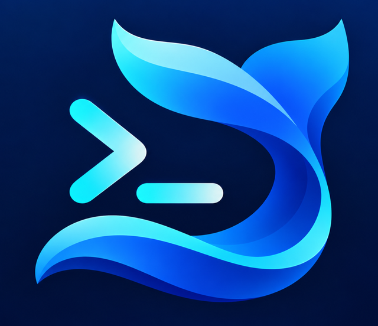
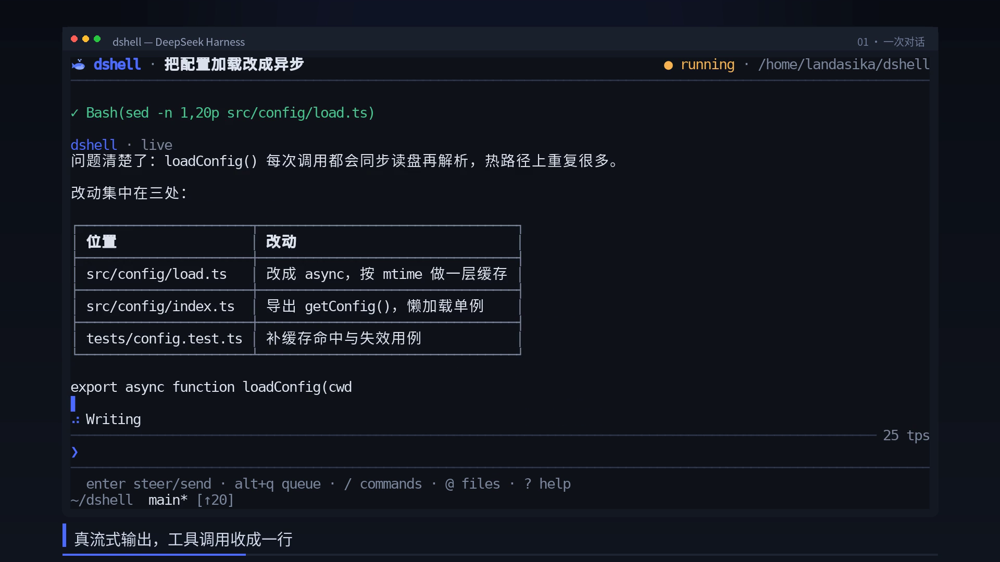

<p align="center">
  
</p>

<h1 align="center">dshell</h1>

<p align="center">
  <b>A Claude Code-style terminal frontend for DeepSeek Harness.</b><br/>
  The same Host, the same sessions, the same Agents — with a keyboard-first TUI.
</p>

<p align="center">
  <a href="docs/promo/out/dshell-promo.mp4"></a>
  
  
  <a href="https://github.com/Landasika/dshell/actions/workflows/ci.yml"></a>
  
  
</p>

<p align="center">
  <a href="#install">Install</a> ·
  <a href="#keyboard">Keyboard</a> ·
  <a href="#cli">CLI</a> ·
  <a href="docs/TUI-DESIGN.md">Design</a> ·
  <a href="CHANGELOG.md">Changelog</a>
</p>

---

## Why

DeepSeek Harness already ships a Web UI. `dshell` adds a second frontend
without adding a second brain:

- it never starts another Host, never copies durable events into a second
  truth, and never owns an Agent;
- quitting the terminal only closes a view — the turn keeps running;
- the Web UI, a TUI and a scripted CLI can watch and drive the **same live
  session at the same time**, and approvals resolve first-answer-wins.

```text
                    one dsh Host
        ┌──────────────────────────────────┐
        │ ctx.agents / ctx.sessions        │
        │ ctx.workspaceRegistry            │
        │ ctx.sessionQuery / ctx.approval  │
        └───────────────┬──────────────────┘
                        │
        ┌───────────────┴──────────────────┐
        │  @landasika/dshell Host plugin   │
        │  $DSH_HOME/run/dshell.sock       │
        └───────────────┬──────────────────┘
                        │ NDJSON, no token
             ┌──────────┴──────────┐
             │   dshell TUI / CLI  │
             └─────────────────────┘
```

**V1 targets Linux.** Tested against Node 22/24 and DSH `0.2.1-rc.2`; see
[Supported versions](docs/SUPPORTED-VERSIONS.md).

## Demo

<p align="center">
  <a href="docs/promo/out/dshell-promo.mp4">
    
  </a>
  <br/>
  <sub>1:27 · one conversation, folded tools, steering, approvals, session switching</sub>
</p>

The video is silent; the narration is in the captions. Storyboard and
re-recording notes: [docs/promo/STORYBOARD.md](docs/promo/STORYBOARD.md).

## Highlights

- **Streaming markdown** — headings, lists, quotes, fenced code, diffs and
  boxed **tables** with per-column alignment; CJK and emoji count as two cells
  so borders stay square.
- **Folded tool calls** — one line each, Claude Code style
  (`✓ Bash(rg --files -g "*.ts")`). `Ctrl-O` expands arguments and output;
  `Alt-↑/↓` + `Enter` opens a scrollable detail panel.
- **Thinking, folded and streamed** — `⚓ thinking · 412 tok · ctrl+o` with the
  last three reasoning lines on a dim rail; live reasoning streams in place.
- **Steer or queue** — `Enter` sends into the running turn, `Alt-Q` queues the
  prompt for the next one, `Alt-Backspace` drops a queued prompt.
- **Approvals you can trust** — answered by a Host bridge that races the Web UI
  fairly: first valid answer wins, everything else fails closed.
- **Questions in the terminal** — `ask_user_question` renders as a selectable
  card (`↑/↓`, `Space`, `c` for a custom answer, `Enter`); timed-out questions
  stay answerable instead of dying with the turn.
- **Subagents** — `⇢ agent started` cards that settle to `✓ finished` / `✗
  failed`; `Ctrl-G` lists children and opens their transcripts read-only.
- **Model & provider control** — `/model` picks provider, model and reasoning
  level from the Host's own catalog; `/provider` edits `cordis.patch.yml`
  surgical lines and offers to restart the Host.
- **Herdr aware** — inside a [Herdr](https://herdr.dev) pane it reports
  `working` / `blocked` / `idle`, the session id and a resume command, with no
  hook to install.
- **Reconnects itself** — a Host restart or plugin reload shows
  `host connection lost · reconnecting`, then `host back · reattached`.

## Status

`0.2.0` is the V1 candidate: Linux only, DSH `0.2.1-rc.2` tested. The P0–P6
plan (TUI, scriptable CLI, sessions/workspaces, approval bridge,
models/providers, subagents, terminal questions) is complete — see the
[changelog](CHANGELOG.md) and [supported versions](docs/SUPPORTED-VERSIONS.md).

## Install

### Prerequisites

- Linux (x64 tested)
- Node `^22.19.0 || >=24.0.0`
- A running DSH Host, `0.2.1-rc.2` tested
- pnpm 11.x if you build from source

### 1. Load the Host plugin

`dshell` is a DSH bundle, so installing it updates `dsh.profile.bundles`:

```bash
git clone https://github.com/Landasika/dshell.git
cd dshell
pnpm install
pnpm build

dsh plugin --profile web add "$PWD"
```

The plugin must be present **when the Host boots** — it cannot be injected into
an already-running Host.

### 2. Start the Host

```bash
dsh --profile web
```

Look for:

```text
[dshell-host] listening on /home/<user>/.dsh/run/dshell.sock
```

### 3. Install the CLI

```bash
npm install -g @landasika/dshell
# or run the built binary directly while developing:
node dist/bin/dshell.js doctor
```

### No global `dsh`? Use the dev wrappers

They boot a Host with the plugin inside an isolated `.dsh-dev/` home (never
touching `~/.dsh`) and auto-detect a bundled DSH runtime:

```bash
# terminal 1 — Host and Web UI
./scripts/dev-host.sh

# terminal 2 — TUI against that Host
./scripts/dev-tui.sh
```

Override `DSH_BIN`, `DSH_HOME` or `DSH_PROFILE` to point elsewhere.

## Quick start

```bash
dshell                      # session picker for the current workspace
dshell --resume <sessionId> # jump straight into a session
dshell --no-color           # plain styling
```

The first screen is the session list — no splash art. `live` / `cold` is the
attachment state; the age is the session's last edit, and the newest is on top.
Inside a session you get the transcript, the composer and the footer rail:

```text
🐳 dshell · session title                              ● running · /project
────────────────────────────────────────────────────────────────────────────
  transcript: streaming markdown, reasoning, tool cards, diffs, approvals
⚓ thinking · 412 tok · ctrl+o expand
│ 先确认每个应用的启动方式，再分派给子代理。
⇢ agent started  接入 OctoPrint harness · 18b9d1cc
⢿ Running command · rg reconnect src · 12s · ctx 84%
▸ 1/3 · Adding bounded backoff                                    ctrl+t hide
✻ Worked for 1m 16s · done 11:19
────────────────────────── ctx ▰▰▰▱▱▱▱▱▱▱ 25% · 42 tps
❯ ask anything
──────────────────────────────────────────────────────────────────────
  enter send · / commands · @ files · ctrl+r history · ? help
deepseek-relay/deepseek-v4.1-flash  ~/dshell  main [↑10]  ✓ agents 1/1  ↑12.4k ↓840
```

## Keyboard

| Key | Action |
| --- | --- |
| `Enter` | send — steers the running turn, otherwise starts one |
| `Alt-Q` | queue the prompt for the next turn |
| `Ctrl-Enter` / `Shift-Enter` | newline in the composer |
| `Tab` | complete `/` commands and `@` files |
| `↑` / `↓` | prompt history |
| `PgUp` / `PgDn`, wheel | scroll the transcript |
| `Alt-↑` / `Alt-↓` | select blocks, then `Enter` to open or `Esc` to clear |
| `Alt-Backspace` | delete the selected queued prompt |
| `Ctrl-O` | expand tools and thinking |
| `Ctrl-T` | fold the todo list |
| `Ctrl-R` | search prompts sent in this session |
| `Ctrl-B` | session panel |
| `Ctrl-G` | subagents (roster + read-only transcript) |
| `Esc` `Esc` | rewind to a previous prompt |
| `End` / `Esc` | jump to the bottom while scrolled up |
| `Ctrl-C` | cancel the turn (or quit when idle) |
| `Ctrl-D` | quit |

In an `ask_user_question` card: `↑/↓` move, `Space` toggles a choice (multi-
select), `c` types a custom answer, `Enter` submits, `Esc` leaves it pending
for the Web UI.

## Slash commands

| Command | Purpose |
| --- | --- |
| `/help` | show keys and commands |
| `/sessions` (`/resume`) | switch session |
| `/workspaces` | switch workspace |
| `/new` | create a session |
| `/attach <id>` | attach by id |
| `/cancel` | cancel the running turn |
| `/clear` | clear the local transcript view |
| `/reconnect` | reattach the current session |
| `/rewind` | restore a previous prompt into the composer |
| `/history` | search prompts sent in this session |
| `/panel` (`/status`) | context, spend, speed, todos |
| `/agents` | list subagents, open their transcripts |
| `/verbose` | toggle reasoning and lifecycle events |
| `/model` | switch provider/model and reasoning level |
| `/provider` | edit provider rows in `cordis.patch.yml` |
| `/quit` | leave the TUI (does not cancel the Host turn) |

## CLI

For scripts and pipes — it never prompts, and any approval is rejected:

```bash
dshell -p "summarize this repository"
dshell -p --session <sessionId> "continue"
dshell -p --new --cwd /path/to/project "initialize the project"
printf 'summarize this repo\n' | dshell -p

dshell -p --json "..."                       # one JSON result object
dshell -p --output-format stream-json "..."  # NDJSON start/event/result
```

`-p` writes only the result to stdout; diagnostics go to stderr. Exit codes:

| Code | Meaning |
| --- | --- |
| 0 | turn completed |
| 1 | Host / connection / protocol / internal error |
| 2 | invalid usage |
| 3 | turn failed, cancelled, or ended abnormally |
| 4 | `--timeout` reached |
| 5 | approval denied in non-interactive mode |
| 130 | SIGINT |

<details>
<summary>Low-level commands and options</summary>

```bash
dshell doctor
dshell workspaces
dshell list [workspaceId]
dshell new [cwd]
dshell attach <sessionId>
dshell prompt <sessionId> '…'
dshell steer <sessionId> '…'
dshell cancel <sessionId>
```

```text
--socket <path>       control socket override
--timeout <ms>        turn timeout (default 120000)
--verbose             context/lifecycle diagnostics
--resume <id>, -r     TUI: open a session directly
--no-color            disable ANSI colors
-p, --print           one-shot mode
--output-format <f>   text | json | stream-json
--json                shorthand for --output-format json
-s, --session <id>    use an existing session
-w, --workspace <id>  workspace for a new session
--cwd <path>          cwd for a new session
--new                 always create a session
```

</details>

## How it works

- The **Host owns** every live Agent and Session.
- The **plugin** holds the Agent handles it resumes; a CLI disconnect only
  drops subscriptions.
- Durable truth is `session/event`; `agent/assistant-stream` is a live
  presentation channel only.
- **One Host per `DSH_HOME`** — a second Host refuses to bind the same socket.
- The plugin is a DSH bundle (`package.json:dsh.bundle.patch`); **no DSH source
  changes** are required.

The socket is `$DSH_HOME/run/dshell.sock`, directory `0700`, socket `0600`,
and there is no token or cookie: run dshell as the user that started the Host.

## Approvals and safety

- Approvals are bridged by the Host plugin; the Web UI and any dshell client
  race, and the **first valid answer wins**.
- The bridge registers with `{ global: true, prepend: true }` so an
  agent-scoped Web answerer cannot starve it.
- Timeout, Host shutdown, request abort and last-watcher disconnect return
  `unavailable` — they never auto-allow.
- `dshell prompt` on a TTY asks `[a]llow once / [r]eject`; non-TTY rejects.
- `dshell -p` always rejects and exits `5`.
- Approval request ids come from the Host bridge, never from a replayed
  `approval/asked` durable event.

## Configuration

```text
DSH_HOME              DSH home (default: ~/.dsh)
DSHELL_SOCKET         control socket override
DSHELL_NO_HERDR=1     disable the Herdr reporter
```

Providers live in `$DSH_HOME/cordis.patch.yml` (else the active profile's).
`/provider` edits them in place — `baseURL`, `apiKeyEnv`, `displayName`, model
lists — and only touches the lines it needs, so comments, model lists and
`!!js` expressions survive. Secrets are never written there: the file carries
the environment-variable name and the key stays in the environment or DSH's
credential store. Providers are read at Host boot, so an edit needs the restart
that the confirmation offers.

## Development

```bash
pnpm install
pnpm typecheck   # tsc --noEmit
pnpm lint        # alias of typecheck
pnpm test        # build + node --test (151 tests)
./scripts/ci.sh  # full local gate, including a clean pack/install
```

Release artifacts are verified with `scripts/verify-pack.sh`. The tag workflow
`.github/workflows/release.yml` runs the same gate, uploads the tarball plus
`SHA256SUMS`, and — when the `NPM_TOKEN` secret is configured — publishes it to
npm with provenance.

## Documentation

- [TUI design](docs/TUI-DESIGN.md) — palette, metric sources, responsive rules
- [Supported versions](docs/SUPPORTED-VERSIONS.md)
- [Changelog](CHANGELOG.md)
- Stage notes: [P0 feasibility](docs/dev/00-feasibility.md) ·
  [P1 packaging](docs/dev/01-packaging.md) ·
  [P2 adapter](docs/dev/02-adapter.md) ·
  [P3 session core](docs/dev/03-session-core.md) ·
  [P4 TUI](docs/dev/04-tui.md) ·
  [P5 product CLI](docs/dev/05-product-cli.md) ·
  [P6 compatibility](docs/dev/06-compatibility-release.md)
- Reference: [architecture](find/architecture.md) ·
  [DSH API inventory](find/dsh-api-inventory.md) ·
  [compatibility risks](find/compatibility-risks.md) ·
  [P3](find/p3-evidence.md) · [P4](find/p4-evidence.md) ·
  [P5](find/p5-evidence.md) · [P6](find/p6-evidence.md)

## Contributing

Issues and pull requests are welcome. Before sending a patch, run the local
gate — it is the same one CI runs:

```bash
pnpm typecheck && pnpm lint && pnpm test
./scripts/ci.sh   # adds a clean pack/install round trip
```

Keep changes inside `dshell`; the Host plugin may use the public DSH plugin
API, but never patches DSH itself.

## License

Published as `UNLICENSED` (all rights reserved) while V1 stabilizes.
